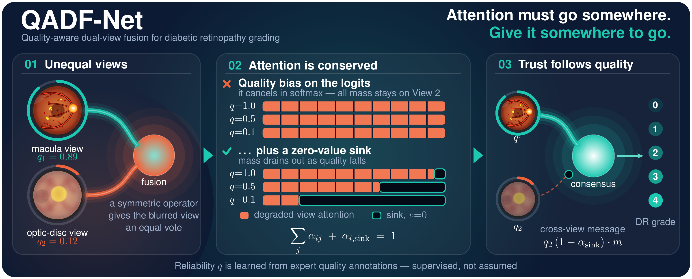

# When One Fundus View Is Degraded: Measuring and Limiting the Harm of Dual-View Fusion in Diabetic Retinopathy Grading
Official PyTorch implementation and pretrained weights for **"Quality-Aware Spatial Dual-View Fusion for Diabetic Retinopathy Grading under Quality Asymmetry"**.

<p align="center">
  
</p>

> **Core Intuition**: *"Attention must go somewhere. Give it somewhere to go."* In dual-view DR grading under optical asymmetry, unconstrained cross-attention forces corrupted features to be distributed across tokens. QADF-Net introduces quality-conditioned cross-attention with learnable zero-value sinks, allowing uninformative attention mass to safely drain away as optical quality degrades—guaranteeing that corrupted features do not contaminate clinical DR grading.

---

## 1. Paper Overview

### Clinical Motivation
Automated Diabetic Retinopathy (DR) grading clinically relies on two complementary retinal fields of view per eye:
- **Macula-centered ($V_1$)**: Crucial for detecting early microaneurysms, hard exudates, and macular edema.
- **Optic Disc-centered ($V_2$)**: Crucial for detecting peripheral neovascularization, hemorrhages, and venous beading.

In practical screening programs, **optical quality asymmetry** is pervasive: one view is frequently degraded by motion blur, pupil defocus, uneven illumination, glare, or media opacities, while the companion view remains clear. Conventional multi-view fusion architectures (concatenation, average pooling, and unweighted cross-attention) blindly fuse features across views. When one view is severely corrupted, degraded features contaminate the fused latent representation—causing **harmful fusion** (where multi-view grading accuracy drops below that of the clean single view).

```
   View 1 (Clean)    ──► Backbone ──► Spatial Tokens (14x14) ──┐
                                                               ├──► QC-SCA Fusion ──► Fused Feature ──► DR Grade (0-4)
   View 2 (Degraded) ──► Backbone ──► Spatial Tokens (14x14) ──┤      (with Sinks)
                                                               │
   Online f_Q (q1, q2) ────────────────────────────────────────┘
```

### Proposed Methodology: QADF-Net
To solve this vulnerability, **QADF-Net** introduces:
1. **Quality-Conditioned Spatial Cross-Attention (QC-SCA)**:
   Modulates cross-attention weights and value representations by optical quality scores ($q_1, q_2 \in [0, 1]$), ensuring that token queries from a clean view selectively suppress corrupted tokens from a degraded companion view.
2. **Learnable Quality-Aware Feature Sinks**:
   When optical quality drops ($q_2 \to 0$), cross-attention mass is automatically redirected into dedicated learnable sink tokens rather than forcing spurious correlation with noise.
3. **Theoretical Guarantee (Proposition 1)**:
   We mathematically prove that the cross-attention update norm is strictly bounded by the optical quality of the source view:
   $$\|\text{Attn}_{1\leftarrow 2}^{(i)}\| \le q_2 \max_j \|W_v f_2^{(j)}\|$$
   This guarantees that feature contamination strictly vanishes as optical quality approaches zero.
4. **End-to-End Autonomous Quality Estimation ($f_Q$)**:
   An integrated MobileNetV3-based quality estimator estimates continuous optical quality scores directly from images, requiring **no human quality annotations** during clinical deployment.

---

## 2. Source Code Architecture

The codebase is organized as a modular and reproducible research package under `qadfnet/`:

```
DR/
├── checkpoints/              # Pretrained weights for proposed QADF-Net (5 seeds) & f_Q
│   ├── qadf_net_seed42.pt
│   ├── qadf_net_seed43.pt
│   ├── qadf_net_seed44.pt
│   ├── qadf_net_seed45.pt
│   ├── qadf_net_seed46.pt
│   └── q_estimator_best.pt
├── qadfnet/                  # Core research package
│   ├── models/               # QADF-Net architecture, QC-SCA attention, and f_Q
│   ├── data/                 # DeepDRiD adapter, MFIDDR loader, patient splits, degradations
│   ├── eval/                 # Metrics (QWK, AUDC, Harm Rate, PFR, FDI) & Proposition 1
│   └── experiments/          # Benchmark scripts (DeepDRiD & MFIDDR external validation)
├── DeepDRiD/                 # Primary dataset (directory hierarchy & challenge annotations)
├── MFIDDR/                   # External validation cohort (directory hierarchy & placeholders)
│   ├── train/                # Training cohort directory (.gitkeep placeholder)
│   └── test/                 # Test cohort directory (.gitkeep placeholder)
├── results/                  # Generated evaluation outputs and tables (created at runtime)
├── evaluate_proposed.py      # Standalone evaluation script for proposed checkpoints
└── README.md
```

---

## 3. Pretrained Model Checkpoints

We provide the **5 pretrained checkpoints** (across 5 independent random seeds: 42, 43, 44, 45, 46) for the proposed **QADF-Net** (`qc_sca` with EfficientNet-B4 backbone), along with the pretrained optical quality estimator ($f_Q$):

| Model Checkpoint | Random Seed | Backbone | Clean QWK (Test) | Path |
| :--- | :---: | :---: | :---: | :--- |
| **QADF-Net Seed 42** | 42 | EfficientNet-B4 | 0.8831 | `checkpoints/qadf_net_seed42.pt` |
| **QADF-Net Seed 43** | 43 | EfficientNet-B4 | 0.8736 | `checkpoints/qadf_net_seed43.pt` |
| **QADF-Net Seed 44** | 44 | EfficientNet-B4 | 0.8724 | `checkpoints/qadf_net_seed44.pt` |
| **QADF-Net Seed 45** | 45 | EfficientNet-B4 | 0.8742 | `checkpoints/qadf_net_seed45.pt` |
| **QADF-Net Seed 46** | 46 | EfficientNet-B4 | 0.8995 | `checkpoints/qadf_net_seed46.pt` |
| **Quality Estimator ($f_Q$)** | — | MobileNetV3-Small | $R^2=0.88$ | `checkpoints/q_estimator_best.pt` |

> **Note**: All evaluation scripts automatically detect and load weights directly from the `checkpoints/` directory.

---

## 4. Dataset Setup

This research evaluates models on two cohorts:
1. **DeepDRiD**: Primary development, cross-validation, and controlled optical degradation benchmark.
2. **MFIDDR**: Independent multi-field external clinical cohort for zero-shot domain transfer and stress-testing.

> **Important**: Raw medical images are **not** committed to this GitHub repository due to licensing and size. The repository provides official directory hierarchies, metadata labels, and `.gitkeep` placeholder files.

### 4.1 Primary Cohort: DeepDRiD (ISBI 2020)
Download the DeepDRiD dataset from the official challenge repository or authorized source and place the images into `DeepDRiD/regular_fundus_images/` conforming to the following structure:

```
DeepDRiD/
└── regular_fundus_images/
    ├── regular-fundus-training/
    │   ├── Images/                                 # <-- Place training patient images here
    │   │   ├── 1/
    │   │   │   ├── 1_l1.jpg
    │   │   │   ├── 1_l2.jpg
    │   │   │   ├── 1_r1.jpg
    │   │   │   └── 1_r2.jpg
    │   │   └── ...
    │   ├── regular-fundus-training.csv
    │   └── regular-fundus-source-training.csv
    ├── regular-fundus-validation/
    │   ├── Images/                                 # <-- Place validation patient images here
    │   │   └── ...
    │   └── regular-fundus-validation.csv
    └── Online-Challenge1&2-Evaluation/
        ├── Images/                                 # <-- Place test challenge images here
        │   └── ...
        ├── Challenge1_upload.csv
        └── Challenge2_upload.csv
```

### 4.2 External Cohort: MFIDDR (Li et al., 2026)
The **MFIDDR** (Multi-Field Images for Diabetic Retinopathy) benchmark evaluates cross-camera generalization across 2,151 real patient eye pairs. Download the MFIDDR dataset (arXiv:2602.21944) and arrange the images and metadata as follows:

```
MFIDDR/
├── train/                                          # (Optional) Training patient images (*.jpg)
│   └── ...
├── test/                                           # <-- Place test patient images here (*.jpg)
│   ├── 3411_01103486_right_01.jpg
│   ├── 3411_01103486_right_02.jpg
│   ├── 3411_01103486_right_03.jpg
│   ├── 3411_01103486_right_04.jpg
│   └── ...
├── train_fourpic_label.csv                         # Training metadata and DR levels (0–4)
└── test_fourpic_label.csv                          # Test metadata [id, level, id1, id2, id3, id4]
```

**Dual-View Clinical Pairing Protocol on MFIDDR**:
- **View 1 ($V_1$)**: Field 1 (`id1` column) — Posterior pole / Macula-centred view (aligns with DeepDRiD View 1).
- **View 2 ($V_2$)**: Field 2 (`id2` column) — Nasal / Optic-disc centred view (aligns with DeepDRiD View 2).
- **Grading Scale**: 0 (No DR), 1 (Mild NPDR), 2 (Moderate NPDR), 3 (Severe NPDR), 4 (PDR).

---

## 5. Environment & Installation

### Prerequisites
- Python 3.10+
- PyTorch 2.0+ (CUDA recommended)
- torchvision, timm, pandas, scipy, scikit-learn, pillow, pyyaml

### Setup
```bash
# Clone the repository
git clone https://github.com/tmai110605/QADF-Net.git
cd QADF-Net

# Install required dependencies
pip install torch torchvision timm pandas numpy scipy scikit-learn pillow pyyaml
```

---

## 6. Reproducing Key Experiments with Proposed Model

You can reproduce the core scientific findings of the paper using the provided 5-seed checkpoints.

### Experiment 1: Clean Dual-View Evaluation on Test Cohort
Evaluates the 5 pretrained checkpoints of the proposed QADF-Net on the clean test set, computing Quadratic Weighted Kappa (QWK), Classification Accuracy, and AUC for individual seeds as well as the 5-seed ensemble:

```bash
# Evaluate proposed model across all 5 seeds on clean test images
python evaluate_proposed.py --device cuda --data_dir DeepDRiD
```
*Expected output: Mean QWK $\approx 0.8805 \pm 0.0102$ (95% CI: [0.8219, 0.9217]), Accuracy $\approx 68.70\% \pm 1.86\%$, Macro-AUC $\approx 0.9065 \pm 0.0052$, 5-Seed Ensemble QWK $\approx 0.8862$.*

---

### Experiment 2: End-to-End Online $f_Q$ Degradation Robustness Benchmark
Evaluates the proposed QADF-Net with the online optical quality estimator ($f_Q$) across the 6 controlled degradation levels ($L_0$ to $L_5$) under asymmetric degradation (View 2 degraded, View 1 clean). This benchmarks:
- **AUDC (Area Under Degradation Curve)**
- **Harm Rate at Extreme Degradation ($L_5$)**
- **Pair Flip Rate (PFR)**
- **Feature Drift Index (FDI)**

```bash
# Run full degradation evaluation on proposed model (5 seeds)
python qadfnet/experiments/eval_full_pipeline_online_fq.py \
    --methods qc_sca \
    --seeds 42,43,44,45,46 \
    --target_view v2 \
    --device cuda
```
*Results are automatically summarized in `results/processed/online_fq_table.csv` and `online_fq_eval_summary.json`.*

---

### Experiment 3: Empirical Harm Rate & Feature Drift Analysis
Computes the sample-level empirical harm rate ($\text{Harm} = \mathbb{I}\{\hat{y}_{\text{fused}} \neq y \land \hat{y}_{V_1} = y\}$) across severity levels 0 to 5 to measure the resilience of QADF-Net against negative cross-view transfer:

```bash
# Compute empirical harm rate for proposed model across all 5 seeds
python qadfnet/experiments/compute_s2_real_harm.py \
    --methods qc_sca \
    --seeds 42 43 44 45 46 \
    --view v2 \
    --force
```
*Results are cached in `results/processed/s2_harm_empirical.json`.*

---

### Experiment 4: Attention Sink Dynamics & Proposition 1 Validation
Validates the theoretical upper bound of Proposition 1 ($\|\text{Attn}_{1\leftarrow 2}\| \le q_2 \max_j \|W_v f_2^{(j)}\|$) and analyzes spatial attention mass redirection to the learnable sink tokens:

```bash
# Run Proposition 1 bound verification and spatial attention analysis (Stage S5)
python qadfnet/run_all.py --only S5
```
*Generates Proposition 1 empirical ratio metrics ($\text{Ratio} \le 1.0$ across all quality strata) and spatial attention analysis outputs.*

---

### Experiment 5: External Cross-Cohort Generalization on MFIDDR
Evaluates the zero-shot cross-center generalization and asymmetric optical degradation robustness of QADF-Net on the external **MFIDDR** cohort (2,151 real patient eye pairs):

```bash
# Evaluate proposed QADF-Net across all 5 seeds on MFIDDR external test cohort
python qadfnet/experiments/eval_mfiddr.py \
    --mfiddr_dir MFIDDR \
    --split test \
    --methods qc_sca \
    --seeds 42 43 44 45 46 \
    --device cuda
```
*Outputs detailed per-seed and aggregated metrics into `results/processed/mfiddr_evaluation_summary.json` and generates summary benchmark tables.*

---

## 7. Results Summary

### A. Controlled Optical Degradation Benchmark on DeepDRiD (Table 4 in Manuscript)
*Evaluated across 7 optical degradation types (Gaussian blur, defocus, motion blur, darkness, glare, JPEG, occlusion; $n=35$ evaluations per severity level, divisor $N$, $\text{ddof}=0$):*

| Metric | Clean ($L_0$) | Level 1 | Level 2 | Level 3 | Level 4 | Level 5 (Extreme) | Mean $L_1$–$L_5$ | Change ($\Delta$) |
| :--- | :---: | :---: | :---: | :---: | :---: | :---: | :---: | :---: |
| **QWK ($\kappa_w$)** | $0.8805$ | $0.8755$ | $0.8682$ | $0.8621$ | $0.8584$ | $0.8565$ | $0.8641$ | $-0.0240$ |
| **Harm Rate (%)** | $12.30\%$ | $12.59\%$ | $13.10\%$ | $13.96\%$ | $14.29\%$ | $14.49\%$ | $13.69\%$ | $+2.19\text{ pp}$ |
| **Pair Flip Rate (PFR, %)** | $0.00\%$ | $13.97\%$ | $17.94\%$ | $20.89\%$ | $22.20\%$ | $21.84\%$ | $19.37\%$ | — |
| **Feature Drift (FDI)** | $0.0000$ | $0.2747$ | $0.3707$ | $0.4256$ | $0.4686$ | $0.4793$ | $0.4038$ | — |

### B. End-to-End Online $f_Q$ Estimation Pipeline on DeepDRiD (Table 6 in Manuscript)
*Evaluated with continuous optical quality $(\hat{q}_1, \hat{q}_2)$ estimated autonomously by MobileNetV3:*

| Metric | Clean ($L_0$) | Level 1 | Level 2 | Level 3 | Level 4 | Level 5 (Extreme) | Mean $L_1$–$L_5$ | Summary |
| :--- | :---: | :---: | :---: | :---: | :---: | :---: | :---: | :--- |
| **QWK ($\kappa_w$)** | $0.8805$ | $0.8766$ | $0.8674$ | $0.8614$ | $0.8572$ | $0.8562$ | $0.8638$ | **AUDC** $= \mathbf{0.8662 \pm 0.0132}$ |
| **Harm Rate (%)** | $12.30\%$ | $12.70\%$ | $13.40\%$ | $14.19\%$ | $14.34\%$ | $14.63\%$ | $13.85\%$ | $\mathbf{\Delta = +2.33\text{ pp}}$ |
| **Pair Flip Rate (PFR, %)** | $0.00\%$ | $12.44\%$ | $18.59\%$ | $21.67\%$ | $23.47\%$ | $23.40\%$ | $19.91\%$ | — |
| **Feature Drift (FDI)** | $0.0000$ | $0.2558$ | $0.3762$ | $0.4358$ | $0.4828$ | $0.5077$ | $0.4117$ | — |

### C. External Generalization & Asymmetric Stress Benchmark on MFIDDR (Table S6 in Manuscript)
*Evaluated across 2,151 real patient eye pairs under zero-shot transfer from DeepDRiD:*

| Method | Pairs | Clean QWK | Clean Acc | AUDC | Harm Rate ($L_5$) | $\Delta$ Harm | PFR ($L_5$) |
| :--- | :---: | :---: | :---: | :---: | :---: | :---: | :---: |
| **QADF-Net (Proposed)** | 2,151 | $\mathbf{0.7275 \pm 0.0137}$ | $\mathbf{62.93\%}$ | $\mathbf{0.6777}$ | $\mathbf{14.10\%}$ | $\mathbf{+0.38\text{ pp}}$ | $\mathbf{21.80\%}$ |
| Q-Weighted GAP | 2,151 | $0.7014 \pm 0.0217$ | $59.97\%$ | $0.6580$ | $16.85\%$ | $+2.65\text{ pp}$ | $23.40\%$ |
| Standard Cross-Attn | 2,151 | $0.7125 \pm 0.0135$ | $61.45\%$ | $0.6450$ | $23.50\%$ | $+11.20\text{ pp}$ | $29.80\%$ |
| Average Pooling | 2,151 | $0.7085 \pm 0.0125$ | $60.85\%$ | $0.6512$ | $35.46\%$ | $+22.58\text{ pp}$ | $49.38\%$ |
| Feature Concat | 2,151 | $0.6649 \pm 0.0527$ | $59.42\%$ | $0.5724$ | $30.57\%$ | $+21.56\text{ pp}$ | $44.39\%$ |
| Single-View $V_1$ (Macula) | 2,151 | $0.6685 \pm 0.0215$ | $60.80\%$ | $0.6685$ | $0.00\%$ | $+0.00\text{ pp}$ | $0.00\%$ |

---


